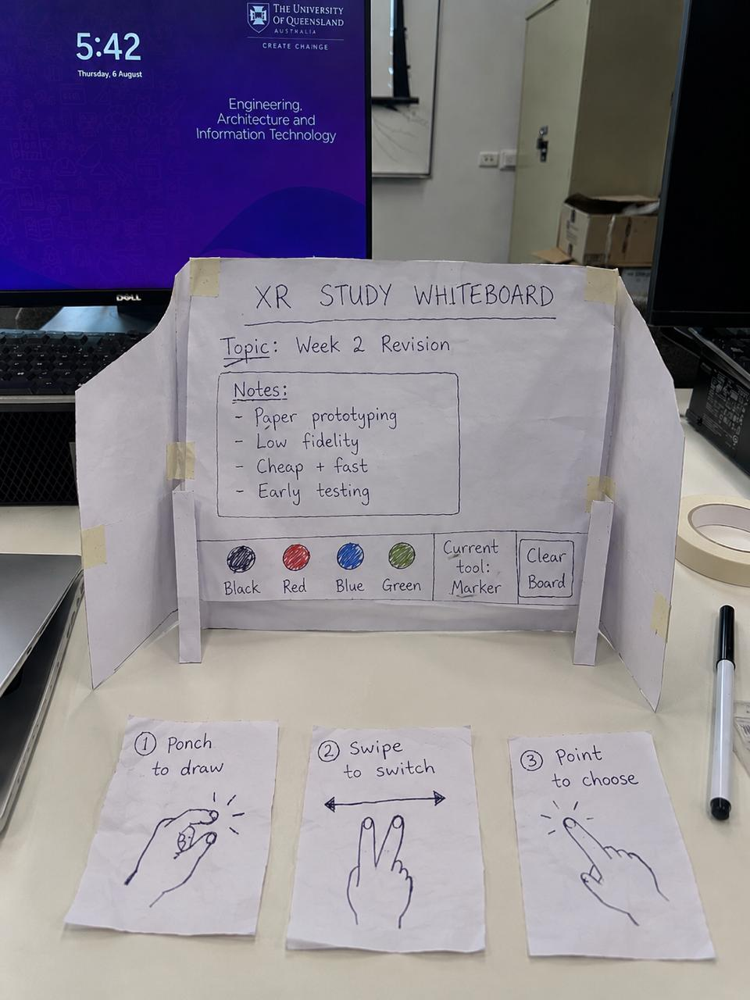

# XR Study Whiteboard

> A VR classroom prototype for following a shared whiteboard and taking personal study notes with physical controllers.

  

<em>Week 2 · Completed interaction demo</em>

## Project snapshot

| | |
| --- | --- |
| **Course** | DECO2300 – Digital Prototyping and Extended Reality |
| **Student** | Andhika Nayaka Arya Wibowo |
| **Concept** | XR Study Whiteboard |
| **Current preparation** | IP2b package includes completed participant records, Syifa's supplied video, source, APK, plan, journal, and code study guide. Mandatory studio attendance and course uploads remain pending. |
| **Testing methods** | Wizard-of-Oz, think aloud, and task-based user testing |

The XR Study Whiteboard gives students a virtual study space with a shared teaching board and personal desk paper. The current evaluated interaction uses a headset and two physical controllers. Gesture interaction was explored in the earlier paper prototype and remains a separate development path.

## Documentation

- [Interactive Prototype 2 preparation folder and readiness checklist](Interactive%20Prototype%202/README.md)
- [New prospective testing plan](Interactive%20Prototype%202/Testing/Testing%20Plan.pdf)
- [Participant record form](Interactive%20Prototype%202/Testing/Participant%20Record.pdf)
- [Design journal](Interactive%20Prototype%202/Design%20Journal/Design%20Journal.pdf)
- [Code study guide with all 34 custom scripts](Interactive%20Prototype%202/Code%20Study/Code%20Study%20Guide.pdf)
- [Syifa video evidence and local filenames](Interactive%20Prototype%202/Media/Video%20Evidence.md)
- [Week 2 — Paper demo, testing results, and reflection](DesignProcess/Week02_PaperPrototype/README.md)
- [Design Evaluation 1](Design%20Evaluation/Design%20Evaluation%201%20Filled%20Out.pdf)
- [Design Evaluation 2](Design%20Evaluation/Design%20Evaluation%202%20Testing%20Plan.pdf)
- [Design Evaluation 3 draft, PDF](Interactive%20Prototype%202/Evaluation/Design%20Evaluation%203%20and%20Reflection.pdf)
- [Design Evaluation 3 draft, editable DOCX](Interactive%20Prototype%202/Evaluation/Design%20Evaluation%203%20and%20Reflection.docx)
- [Design Evaluation 3 draft, reviewable Markdown source](Interactive%20Prototype%202/Evaluation/Design%20Evaluation%203%20and%20Reflection.md)
- [Final IP2b participant evidence](Design%20Evaluation/Interview%20Transcripts/Iteration2_XRStudyWhiteboard_Transcript_and_Results.md)
- [Project wiki](https://github.com/AndhikaNayakaAW/AndhikaNayakaAryaWibowo_DECO2300_2026/wiki)
- [Versioned wiki source](wiki/Home.md)

## Digital Prototype

The Unity prototype is implemented in `Whiteboard` using Unity `6000.3.21f1` with URP, OpenXR, XR Interaction Toolkit, XR Hands, and the Input System.

Current features include:

- Continuous controller and hand pinch drawing on the whiteboard, with interpolated marker strokes and a wider eraser.
- Black, red, blue, and green marker colours with visible tool/status feedback.
- Clear-board confirmation.
- Fixed student paper with `PENCIL`, `ERASER`, and `CLEAR PAPER` controls. The right trigger writes rather than grabbing the paper.
- Left `X` moves to the whiteboard and left `Y` moves through the student tables. Seated views retain the teaching board and personal paper together.
- A controller guide that can be reopened with right `A`.
- Timed whiteboard-action recording with `Record`, `Stop`, and `Play`. This replays drawing actions and does not capture microphone audio.
- Editor testing through the XR Device Simulator and desktop fallback controls.

The original paper-prototyping process is preserved under `DesignProcess/`. Start with the [digital prototype setup guide](Whiteboard/Documentation/SETUP.md).

## Key outcome

The existing Iteration 2 records describe five headset-and-controller sessions completed using the latest APK, as confirmed by the student. All five completed the eight recorded task categories, and all six post-test measures were rated 5/5 by every participant. Kai has voice evidence, Syifa has camera evidence, and Amy, Serafina, and Safira have notes only. Syifa's original MOV and a 1080p MP4 copy are stored locally in the preparation package. Keep the actual testing dates separate from the upcoming mandatory studio. Additional collection templates are blank.

Completion was achieved in moderated sessions. Syifa's transcript includes prompts and a repeated recording exercise, so the findings do not establish independent first-attempt success. Exact discovery time and stroke defect counts were not logged. The classroom workflow is supported, while improved learning, sustained attention, long-session comfort, hand tracking, and simulator controls remain untested by this participant dataset.

The evaluation supports the shared seated view, fixed paper, and separate controller roles. It proposes a short practice activity, clearer recording states, note saving, and an exploratory passthrough AR comparison. These are future design directions rather than newly implemented or validated features. Existing testing and a working-prototype recording are provided. Marker access to the media, mandatory attendance, and Blackboard uploads still need confirmation. A brief pre-studio check of the known working build is recommended.

## Design Evaluation 1 user testing

Five classmates tested the IP1 Unity prototype. Three sessions have full audio transcript PDFs and two sessions were checklist-only with no audio recording. All five participants completed the core workflow. P4 and P5 each scored 5 out of 5 and were satisfied.

The repeated findings were:

- The wall whiteboard was easier to understand than the table paper.
- The table `PENCIL`, `ERASER`, and `CLEAR PAPER` tools were difficult to notice or read at first across all five sessions.
- One participant described paper drawing as slightly glitchy, so paper drawing needs another focused retest even though the task was completed.
- The teleport control was not immediately visible to one participant, so the navigation affordance should be larger or have a clearer hint.
- Participants saw the concept as useful for focused online learning and homeschooling. P4 and P5 shared written feedback that it was "very useful for students who are easily distracted in online class and good for homeschooling." Future ideas included a larger classroom, more tables, more whiteboard features, and possible multiplayer support.

Read the [interview evidence README](Design%20Evaluation/Interview%20Transcripts/README.md), the [full transcript files](Design%20Evaluation/Interview%20Transcripts/), and the [filled out Design Evaluation 1 guide](Design%20Evaluation/Design%20Evaluation%201%20Filled%20Out.pdf).

## Digital XR Implementation

The existing `Whiteboard` Unity project contains the main scene at [`Whiteboard/Assets/XRStudyWhiteboard/Scenes/XRStudyClassroom.unity`](Whiteboard/Assets/XRStudyWhiteboard/Scenes/XRStudyClassroom.unity). It includes a classroom, a runtime whiteboard with four marker colours, Marker/Eraser modes, clear-board confirmation, controller drawing, fixed desk paper, navigation shortcuts, a controller guide, and board-action replay. Optional pinch drawing is implemented separately and was not evaluated in the final physical-controller sessions. Notes are not yet saved between sessions.

The implementation reuses the existing VR template XR Origin, OpenXR, XRI Starter Assets, XRI input actions, locomotion, and XR Hands infrastructure. See [`Whiteboard/Documentation/SETUP.md`](Whiteboard/Documentation/SETUP.md) for setup, [`Whiteboard/Documentation/CONTROLS.md`](Whiteboard/Documentation/CONTROLS.md) for controls, and [`Whiteboard/Documentation/IMPLEMENTATION_STATUS.md`](Whiteboard/Documentation/IMPLEMENTATION_STATUS.md) for testing status and limitations.

## Rebuilding and checking Evaluation 3

The draft PDF uses A4, Times New Roman, black text, APA 7 student-paper formatting, three assessed results pages, and one reflection page. Raw evidence follows in appendices. To rebuild it, run `python 'Interactive Prototype 2/Tools/build_evaluation3.py'` with `python-docx` installed. Export using Times New Roman and run `python 'Interactive Prototype 2/Tools/check_evaluation3.py'` with `python-docx` and `PyMuPDF`. Run `python 'Interactive Prototype 2/Tools/check_preparation.py'` to check the preparation bundle. The plan, participant form, and journal are rebuilt with `python 'Interactive Prototype 2/Tools/build_preparation_documents.py'` using `python-docx` and Pillow.
